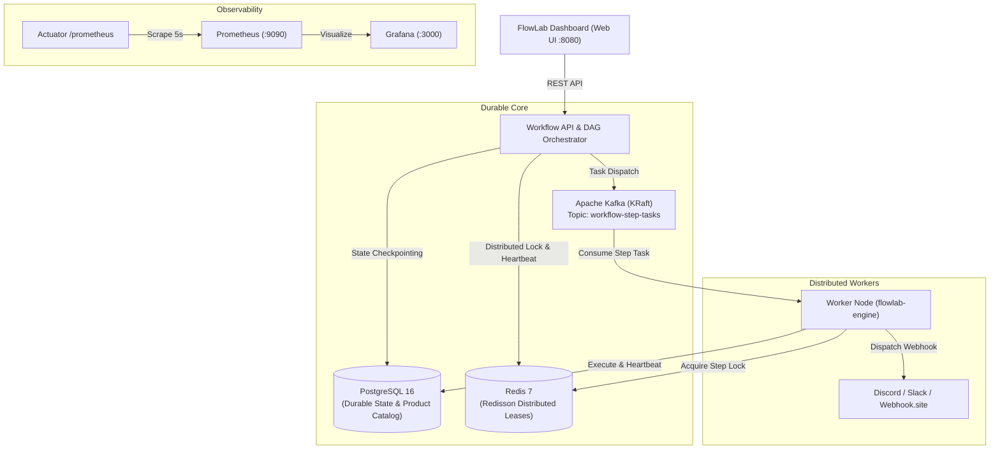

# FlowLab — Crash-Proof Distributed Workflow Engine

[](https://openjdk.org/)
[](https://spring.io/projects/spring-boot)
[](https://www.postgresql.org/)
[](https://redis.io/)
[](https://kafka.apache.org/)
[](https://prometheus.io/)
[](https://grafana.com/)
[](LICENSE)

> A production-grade, distributed, durable execution workflow engine managing multi-step transactional pipelines. FlowLab features **DAG fork-join execution**, **distributed Saga pattern compensating transactions**, **Kafka-driven worker decoupling**, **Redis distributed locks**, **Prometheus/Grafana observability**, and **automated self-healing verified under Chaos Monkey process termination**.

---

## 📸 Directed Acyclic Graph (DAG) Pipeline

Unlike basic sequential orchestrators, FlowLab models workflows as a Directed Acyclic Graph with parallel branching and synchronization barriers:

```mermaid
flowchart TD
    S0["🛒 0. Validate Order\n(ACID Stock Verification)"] --> S1["🛡️ 1. Fraud Risk Check\n(⚡ PARALLEL BRANCH)"]
    S0 --> S2["📍 2. Warehouse Hub Routing\n(⚡ PARALLEL BRANCH)"]
    
    S1 --> S3["💳 3. Process Payment\n(Fork-Join Barrier & Idempotency)"]
    S2 --> S3
    
    S3 --> S4["📦 4. Update Inventory\n(Atomic PostgreSQL Deduction)"]
    S4 --> S5["✉️ 5. Send Notification\n(Receipt & Discord/Slack Webhook)"]

    style S1 fill:#1e1b4b,stroke:#818cf8,stroke-width:2px
    style S2 fill:#042f2e,stroke:#2dd4bf,stroke-width:2px
    style S3 fill:#1f2937,stroke:#60a5fa,stroke-width:2px
```



---

## 🏛️ System Architecture



---

## ⚡ Core Distributed Systems Highlights

### 1. Directed Acyclic Graph (DAG) Parallel Execution
Steps declare dependencies via `getDependencies()`. When Step 0 (`Validate Order`) completes, both Step 1 (`Fraud Risk Check`) and Step 2 (`Warehouse Routing`) are dispatched concurrently across distributed Kafka partitions. Step 3 (`Process Payment`) acts as a synchronization barrier, evaluating only when all upstream branches have successfully completed.

### 2. Distributed Saga Pattern (Compensating Transactions)
If an unrecoverable failure occurs downstream (e.g. physical inventory compromise at Step 4), the engine prevents dirty state by initiating a backward Saga rollback:
- Walks backwards through completed steps (`Order 3 -> 2 -> 1 -> 0`).
- Executes `ProcessPaymentStep.compensate()`: issues an automatic refund (`REF-...`) and dispatches a refund webhook alert.
- Releases warehouse reservations and marks the workflow as `COMPENSATED`.

### 3. Kafka-Driven Worker Decoupling & Redis Distributed Locks
Step dispatching is decoupled via Kafka topic `workflow-step-tasks`. Dedicated consumer threads acquire distributed locks via **Redisson** (`lock:step:{executionId}:{stepIndex}`) with lease timeouts, preventing duplicate execution across multi-node worker clusters.

### 4. Real External Notifications & Webhook Integration
`NotificationService` formats and delivers real JSON webhooks to **Discord**, **Slack**, or **Webhook.site** with transaction IDs, tracking numbers, and color-coded status embeds on both order completion and compensation rollbacks.

### 5. Chaos Monkey Automated Resilience Test
Includes an automated test script (`scripts/chaos_monkey.py`) that initiates a live order, sends `SIGKILL` to the container mid-execution (`docker kill flowlab-engine`), boots the container back up, and asserts:
- `CrashRecoveryService` reclaims orphaned Redis locks and stale heartbeats.
- The step resumes from checkpoint with zero duplicate debits.
- Final state reaches `COMPLETED` with exact stock decrement.

---

## 🚀 Quickstart

### 1. Launch All 6 Services via Docker Compose
```bash
docker compose up -d --build
```

Services exposed:
- **FlowLab Dashboard & Engine:** `http://localhost:8080`
- **Prometheus Metrics:** `http://localhost:9090`
- **Grafana Dashboard:** `http://localhost:3000` (User: `admin` / Pass: `admin`)
- **PostgreSQL:** `localhost:5432` (`flowlab_db`)
- **Redis:** `localhost:6379`
- **Apache Kafka:** `localhost:9092` / `localhost:29092`

---

### 2. Test Live Workflows in Dashboard
Open:
👉 **`http://localhost:8080`**

- **Normal Flow:** Select a product, enter customer info, click **"Place Order & Run"**. Watch all 6 DAG cards turn green with live execution metrics.
- **Test Saga Rollback:** Check `[x] Simulate Fatal (Saga)`. The engine charges payment, hits the inventory disaster, and auto-refunds the payment with a purple `↩️ Refunded` badge.
- **Test Fraud Block:** Check `[x] Simulate Fraud Alert`. The engine blocks high-risk velocity orders immediately at Step 1.
- **Test Live Webhooks:** Paste your Discord / Slack / [Webhook.site](https://webhook.site) URL into the Webhook Alert URL field to receive formatted embeds!

---

### 3. Run Automated Chaos Monkey Test
Stress-test container failure and self-healing:
```bash
python scripts/chaos_monkey.py
```
Output:
```
============================================================
[CHAOS-MONKEY] Starting Crash-Proof Durability Stress Test
============================================================
[1] Initial stock for SKU-IPHONE: 15
[2] Triggered workflow execution: exec_a259e544
[3] Waiting 1.5s for step execution to begin...
[4] KILLING container: docker kill flowlab-engine...
[5] REVIVING container: docker start flowlab-engine...
[6] Monitoring self-healing recovery...
    +36s status: COMPLETED (Step #6)

============================================================
CHAOS MONKEY VERIFICATION SUMMARY
============================================================
  Step #0 [Validate Order]: status=COMPLETED, attempts=1
  Step #1 [Fraud Risk Check]: status=COMPLETED, attempts=1
  Step #2 [Warehouse Routing]: status=COMPLETED, attempts=1
  Step #3 [Process Payment]: status=COMPLETED, attempts=1
  Step #4 [Update Inventory]: status=COMPLETED, attempts=2
  Step #5 [Send Notification]: status=COMPLETED, attempts=1
Stock Before: 15 | Stock After: 14

>>> ALL ASSERTIONS PASSED! <<<
The engine survived container kill, self-healed, and resumed safely with ZERO duplicate debit!
```

---

## 🛠️ API Reference

| Method | Endpoint | Description |
| :--- | :--- | :--- |
| `GET` | `/api/workflows/products` | Retrieve real product catalog with live stock quantities |
| `POST` | `/api/workflows/{workflowId}/start` | Trigger a new DAG workflow execution |
| `GET` | `/api/workflows/executions/{executionId}` | Retrieve execution details, status, and error logs |
| `GET` | `/api/workflows/executions/{executionId}/steps` | List step breakdown with durations, worker MXBeans, and retry attempts |
| `POST` | `/api/workflows/executions/{executionId}/resume` | Manually resume an execution from last failure checkpoint |
| `GET` | `/actuator/prometheus` | Prometheus scrape endpoint with custom workflow metrics |

---

## 📄 License
This project is licensed under the MIT License.
