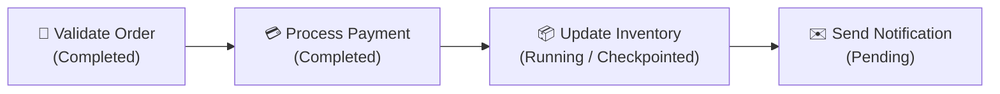
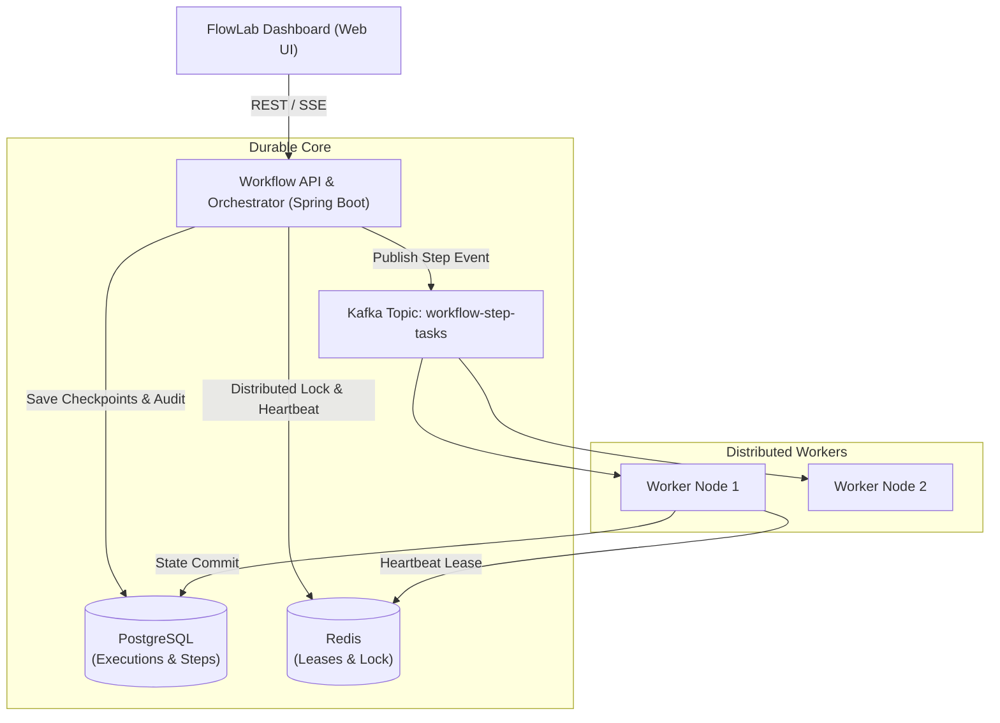

# FlowLab — Crash-Proof Workflow Engine

[](https://openjdk.org/)
[](https://spring.io/projects/spring-boot)
[](https://www.postgresql.org/)
[](https://redis.io/)
[](https://kafka.apache.org/)
[](LICENSE)

> A distributed, durable execution workflow engine built to orchestrate long-running multi-step processes. FlowLab survives sudden node crashes, supports exponential backoff retries, and guarantees resumption from the exact point of failure without duplicate side effects.

---

## 📸 Architecture & Dashboard

FlowLab provides an interactive visual dashboard representing sequential workflow steps, live state transitions, and step execution metrics:



### System Architecture



---

## ⚡ What Makes It "Crash-Proof"?

1. **ACID State Checkpointing:** Every state transition is committed to PostgreSQL before and after step execution.
2. **Heartbeat & Zombie Task Reaper:** If a worker or server crashes mid-step (e.g., during `Update Inventory`), its heartbeat expires. The `CrashRecoveryService` reclaims the lease and automatically resumes execution from that specific step without re-executing completed ones.
3. **Idempotency Guarantees:** Ensures operations like `Process Payment` cannot be double-charged even under network timeouts or duplicate delivery.
4. **Exponential Retries with Jitter:** Gracefully handles transient network or 3rd-party API drops.

---

## 🚀 Quickstart

### Prerequisites
- Docker Desktop
- Java 21 & Maven 3.9+

### 1. Spin up Infrastructure (PostgreSQL, Redis, Kafka)
```bash
docker compose up -d
```

### 2. Run the Engine
```bash
mvn spring-boot:run
```

### 3. Open FlowLab Dashboard
Visit:
```
http://localhost:8080
```

Click **"Start Workflow"** or check **"Simulate Worker Crash"** to watch the engine recover from a simulated crash live!

---

## 🛠️ API Reference

| Method | Endpoint | Description |
| :--- | :--- | :--- |
| `POST` | `/api/workflows/{workflowId}/start` | Trigger a new workflow execution |
| `GET` | `/api/workflows/executions/{executionId}` | Retrieve execution details & status |
| `GET` | `/api/workflows/executions/{executionId}/steps` | List step breakdown with durations & attempts |
| `POST` | `/api/workflows/executions/{executionId}/resume` | Manually resume an execution from checkpoint |

---

## 📄 License
This project is licensed under the MIT License.
